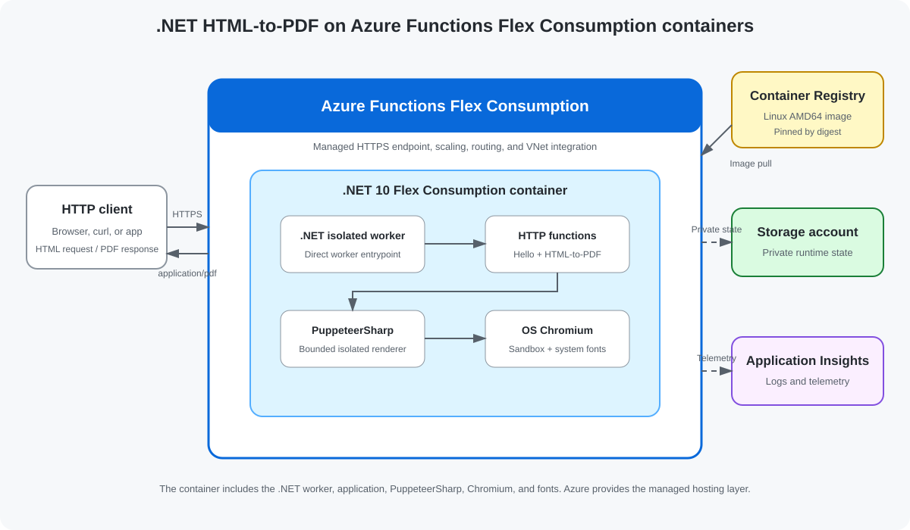

<!--
---
name: .NET HTML-to-PDF on Azure Functions Flex Consumption containers
description: >-
  This sample contains an Azure Functions Flex Consumption container
  application written for .NET 10. It accepts bounded HTML and returns a PDF
  rendered with PuppeteerSharp and OS-installed Chromium.
page_type: sample
languages:
- csharp
- bicep
- azdeveloper
- dockerfile
- powershell
products:
- azure
- azure-functions
- azure-container-registry
urlFragment: flex-container-html2pdf-dotnet
---
-->

# .NET HTML-to-PDF on Azure Functions Flex Consumption containers

This sample accepts self-contained HTML in an HTTP POST request and returns a
PDF rendered with PuppeteerSharp and the operating system's Chromium package.

The Azure Functions app runs from a .NET 10 Flex Consumption container. Azure
Developer CLI (`azd`) provisions the Azure resources, builds the container
with Azure Container Registry Tasks, deploys it by immutable digest, and
verifies the live endpoints.



> [!IMPORTANT]
> Azure Functions Flex Consumption container support is currently in preview.
> Preview capabilities and deployment requirements may change before general
> availability.

## Sample workflow

1. Clone the repository.
1. Run `azd up` to build and deploy the .NET 10 container.
1. POST your HTML to `/api/html-to-pdf`.
1. Save or display the returned `application/pdf` response.

You may use `dotnet test` and the real Chromium integration target to verify
the application locally. During the preview, deploy to Azure for end-to-end
container validation.

## Prerequisites

- [Git](https://git-scm.com/downloads)
- [.NET 10 SDK](https://dotnet.microsoft.com/download/dotnet/10.0)
- [Azure CLI](https://learn.microsoft.com/cli/azure/install-azure-cli)
- [Azure Developer CLI](https://learn.microsoft.com/azure/developer/azure-developer-cli/install-azd)
- an Azure subscription enabled for the Registry-backed Flex Consumption
  container preview
- permission to create resource groups, role assignments, storage, networking,
  monitoring, Azure Container Registry, FC1 plans, and Function Apps

Local Docker isn't required for the `azd` deployment. ACR Tasks builds the
Linux AMD64 image in Azure.

## Initialize the project

```shell
git clone https://github.com/Azure-Samples/flex-container-html2pdf-dotnet.git
cd flex-container-html2pdf-dotnet
```

## How it works

[`HtmlToPdf.cs`](./HtmlToPdf.cs) implements the customer endpoint:

```text
POST /api/html-to-pdf
Content-Type: text/html; charset=utf-8
```

The function:

1. validates the media type, UTF-8 body, and 1 MiB input limit;
1. launches OS-installed Chromium through PuppeteerSharp as a non-root user;
1. disables JavaScript and blocks external subresources;
1. enforces one concurrent render, a 30-second timeout, 20 pages, and a
   10 MiB output limit;
1. validates the PDF signature, trailer, page count, and output size;
1. returns `application/pdf` with no-store and nosniff headers.

GET requests render the deterministic invoice in
[`SampleInvoice.cs`](./SampleInvoice.cs).
[`Hello.cs`](./Hello.cs) also registers the `Hello` function used by
deployment verification.

Exact runtime and dependency pins live in
[`FlexContainerHtmlToPdf.csproj`](./FlexContainerHtmlToPdf.csproj),
[`NuGet.config`](./NuGet.config), and
[`dotnet10.Dockerfile`](./dotnet10.Dockerfile). Those files are the source of
truth for version updates. The current sample uses:

- .NET 10 isolated worker with ASP.NET Core integration;
- `Microsoft.Azure.Functions.Worker` 2.53.0-preview.1;
- HTTP ASP.NET Core extension 2.1.2-preview.1;
- Worker SDK 2.1.0;
- PuppeteerSharp 25.12.0 and PdfPig 0.1.16;
- Alpine Chromium headless shell 149.0.7827.53-r0.

## How the container image is built

The deployment uses
[Azure Container Registry Tasks](https://learn.microsoft.com/azure/container-registry/container-registry-tasks-overview)
to build the Linux AMD64 image in Azure. Customers don't need local Docker to
deploy the sample.

During `azd up`:

1. The deployment hook restores, tests, and publishes the .NET application
   and real-browser validation runner on the local machine.
1. The package-free, standard-library C#
   [`DeployHelper`](./infra/scripts/DeployHelper/DeploymentOperations.cs)
   calculates a deterministic SHA-256 over the source, project, test, NuGet,
   and Docker inputs, then stages the runtime Dockerfile plus the exact
   published outputs.
1. The hash becomes the image tag: `azd-<context-hash>`.
1. An existing tag is reused; otherwise `az acr build` runs the ACR Tasks
   quick build to assemble the runtime image and install Chromium and fonts.
1. The workflow resolves the registry manifest digest.
1. The Function App is pinned to
   `registry/repository:tag@sha256:digest`.
1. The tag is write- and delete-locked so its digest can't move.

NuGet restore doesn't run inside Docker or ACR Tasks. Customers can use their
normal NuGet configuration or approved package mirror for the local publish
step.

## Deploy to Azure

Sign in:

```shell
az login
azd auth login
```

Create an `azd` environment and set the required deployment locations:

```shell
azd env new dotnet-pdf-flex --no-prompt
azd env set AZURE_SUBSCRIPTION_ID <subscription-id>
azd env set AZURE_LOCATION eastus2
azd env set AZURE_FUNCTION_LOCATION eastus2euap
```

`AZURE_LOCATION` is used for storage, ACR, Log Analytics, and Application
Insights. `AZURE_FUNCTION_LOCATION` is used for the FC1 plan, Function App,
virtual network, and private endpoint. The split is required because Log
Analytics isn't available in the preview region.

Provision the resources, build the container, deploy it, and verify the Hello
and PDF endpoints:

```shell
azd up
```

For unattended execution, use `azd up --no-prompt` after all four environment
values are set.

## Test the deployed container

Get the deployed endpoint.

PowerShell:

```powershell
$apiUrl = azd env get-value API_URL
```

Bash:

```bash
API_URL=$(azd env get-value API_URL)
```

POST the included [`sample.html`](./sample.html).

PowerShell:

```powershell
$format = "HTTP %{http_code}; Content-Type %{content_type}; " +
  "Bytes %{size_download}`n"
curl.exe --fail --show-error `
  --request POST `
  --header "Content-Type: text/html; charset=utf-8" `
  --data-binary "@sample.html" `
  --output document.pdf `
  --write-out $format `
  "$apiUrl/api/html-to-pdf"
```

Bash:

```bash
FORMAT='HTTP %{http_code}; Content-Type %{content_type}; Bytes %{size_download}\n'
curl --fail --show-error \
  --request POST \
  --header 'Content-Type: text/html; charset=utf-8' \
  --data-binary @sample.html \
  --output document.pdf \
  --write-out "$FORMAT" \
  "$API_URL/api/html-to-pdf"
```

Expected output resembles:

```text
HTTP 200; Content-Type application/pdf; Bytes 15000
```

The byte count varies but must be greater than zero. Verify the PDF boundaries:

```shell
dotnet run \
  --project ./infra/scripts/DeployHelper \
  -- validate-pdf document.pdf
```

Expected output:

```text
Valid PDF: <non-zero byte count> bytes
```

Open the generated PDF.

Windows:

```powershell
Start-Process .\document.pdf
```

macOS:

```bash
open document.pdf
```

Linux:

```bash
xdg-open document.pdf
```

The displayed PDF should contain:

- **Hello from custom HTML**
- **This document was submitted to the HTML-to-PDF POST endpoint.**

## Redeploy container changes

This section isn't needed for the initial deployment. Use it later if you
change the .NET source, NuGet dependencies, tests, or Dockerfile and want to
deploy an updated container.

Rerun `azd up`, or use the image-only workflow after the environment is
provisioned:

PowerShell:

```powershell
.\infra\scripts\deployimage.ps1 -Verify
```

Bash:

```bash
sh ./infra/scripts/deployimage.sh --verify
```

Unchanged image inputs reuse the existing digest.

## Security

Rendering untrusted HTML invokes a complex browser parser. Before production
use, add authentication, authorization, rate limiting, tenant isolation, abuse
monitoring, and workload-specific HTML sanitization.

This sample:

- uses anonymous HTTP triggers only to simplify the sample;
- keeps ACR admin and anonymous pull disabled;
- grants the Function App a repository-scoped read-only pull credential;
- passes registry secrets only as secure deployment parameters;
- doesn't write secrets to source or `azd` environment outputs;
- uses a user-assigned managed identity for runtime storage and Application
  Insights;
- disables shared-key and public network access on runtime storage;
- reaches runtime storage through a private endpoint and private DNS;
- disables FTP and SCM basic publishing credentials;
- requires HTTPS and TLS 1.2 or later;
- runs the application and Chromium as UID/GID `1654`;
- keeps Chromium's renderer sandbox enabled;
- disables JavaScript and external subresources;
- doesn't accept arbitrary URLs for server-side fetching;
- bounds input, output, concurrency, pages, and execution time.

## Preview limitations

- The direct Registry deployment uses preview Azure resource APIs.
- Region and subscription enablement are required.
- ACR Basic uses a public service endpoint; admin and anonymous access remain
  disabled.
- Runtime storage is private, but the HTTP Function endpoints are public.
- The HTTP endpoints are anonymous.
- The image is Linux AMD64 only.
- The short-lived ACR pull password must be refreshed by rerunning deployment.
- The deployment uses a split-region topology while preview-region service
  availability is limited.

## Costs

The environment can incur charges for:

- Flex Consumption executions;
- Azure Container Registry storage and ACR Tasks builds;
- the storage account and private endpoint;
- Log Analytics and Application Insights ingestion;
- Chromium CPU time and cold starts.

## Clean up resources

Review the selected environment:

```shell
azd env get-values
```

Delete the resource group and all resources created for that environment:

```shell
azd down --force
```

This command doesn't delete the local repository.

## Resources

- [Azure Developer CLI](https://learn.microsoft.com/azure/developer/azure-developer-cli/)
- [Run Azure Functions locally](https://learn.microsoft.com/azure/azure-functions/functions-run-local)
- [Azure Functions Flex Consumption](https://learn.microsoft.com/azure/azure-functions/flex-consumption-plan)
- [.NET isolated worker guide](https://learn.microsoft.com/azure/azure-functions/dotnet-isolated-process-guide)
- [Azure Container Registry Tasks](https://learn.microsoft.com/azure/container-registry/container-registry-tasks-overview)
- [PuppeteerSharp](https://github.com/hardkoded/puppeteer-sharp)

## License

This sample is licensed under the [MIT License](LICENSE.md).
